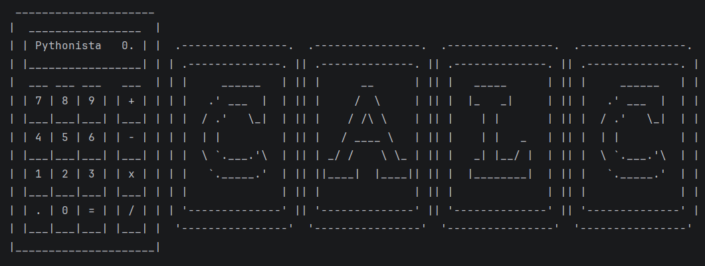

I

> Create 'add' function and write out the other 3 functions -  subtract, multiply, divide

II

> Add these 4 functions into a dictionary as the values. Keys = '1', '2', '3', '4'.

> Use the dictionary operations to perform the calculations. 

e.g. 4 multiply 8 using the dictionary

III

Functionality

> Program asks the user to type an operation(a choice of 'add' or 'sub' or 'mul' or 'div')

> Program asks the user to type the first number

> Program asks the user to type the second number

> Program writes out the result based on the chosen operation_type.

IV

> Program asks if the user likes to continue

> Program asks if the user want to continue working with the previous result

> if yes, program loops to use the previous result as the first number and then repeats the calculation process

> if no, program asks the user for the first number again and wipes all the memory of previous calculations

