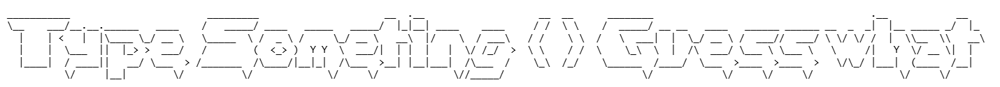

TODOs

I
> Function to set difficulty

II
> Let the user guess a number

III
> Function to check User's guess against actual answer

IV
> Track the number of turns and reduce by 1 if they get it wrong

V
> Repeat the guessing functionality if they get it wrong